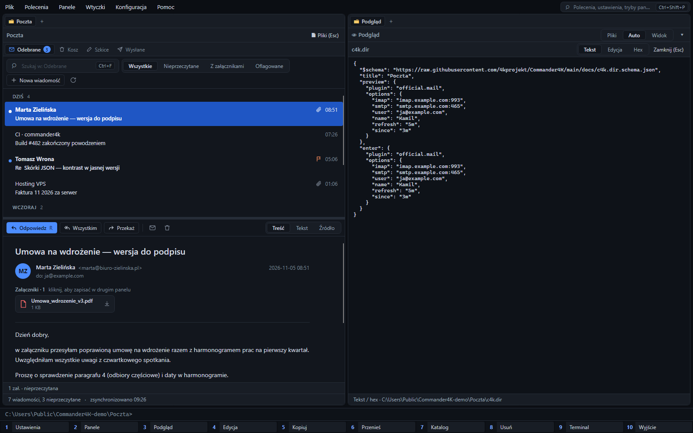
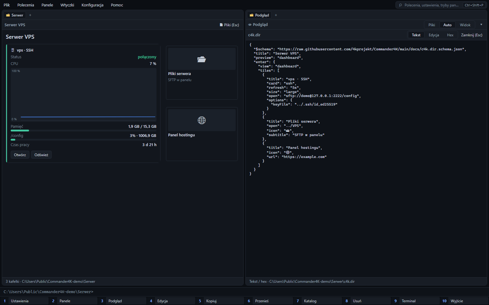
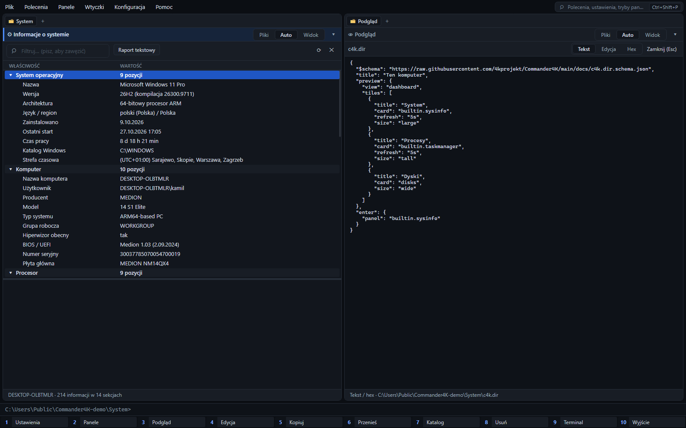

#  Commander4K

[](https://github.com/4kprojekt/Commander4K/actions/workflows/ci.yml)
[](LICENSE)
[-8A2BE2.svg)](#built-with-ai)

**Commander4K** by [4Kprojekt](https://4kprojekt.pl) · website: <https://4kprojekt.github.io/Commander4K/> · [download](https://github.com/4kprojekt/Commander4K/releases/latest)

## Everything is a folder.

A mailbox, a photo gallery, an SFTP server, a Linux box over SSH, this PC's hardware, a dashboard of live cards: in Commander4K each of them is a folder. Small JSON files in the folder, `*.c4k`, say what the folder is. Each file is one item: a view, a plugin, a connection, a link or a command. With one `.c4k` file, `Ctrl+Q` shows that item and `Enter` opens it; with two or more, the folder is a dashboard with one tile per file, in file-name order (rename `01-…`, `02-…` to reorder). `Shift+Enter` always opens the plain file list.

Each panel shows one folder through a plugin. The file list is the default one; a folder's `.c4k` file can name another (mail, gallery, system information, your own plugin). The path bar switches between them: **Pliki** (always files) · **Auto** (the folder's view when it has one) · **Widok** (always a view). Whatever a panel shows, it states what it can send to the other panel and what it accepts from it, so `F5` copies files between folders, saves an attachment from a message, or hands files to a plugin. See [Panels: everything is a folder](docs/plugins.md#panels-everything-is-a-folder).

Commander4K is a fast, keyboard-driven, dual-pane file manager for Windows 11 in the tradition of Norton Commander, Midnight Commander and Total Commander. It is written in C# on .NET 10 with Avalonia UI (no XAML) and runs natively on x64 and ARM64.

> **Status: early preview (0.x).** It works for daily browsing, copying and searching, but expect rough edges and breaking changes.

**Ask an AI agent.** Connect Claude Code (or Codex, Gemini CLI, Cursor, VS Code, Windsurf) to the app over [MCP](#claude-code-and-mcp), then just say what you want:

- *"Make a dashboard for D:\Projects\Shop: KPIs for file count and size, the status of https://shop.example.com, a note from README.md and links to src and docs."*
- *"Design a skin for Commander4K: dark navy, amber accents, square corners, a retro terminal feel."*
- *"Write a Commander4K plugin that previews .csv files as a table with column statistics, then install it."*

The app checks every step and asks before anything is saved or installed. More in [Examples](#examples).

Every screenshot below was taken in the app with the *Modern* skin. The left panel shows the folder as its `.c4k` files describe it, and the right panel shows one of those files. The files are printed under each screenshot, so you can copy them into a folder of your own. Reference: [guide](docs/plugins.md#c4k-files), [schema](docs/c4k.schema.json).

### A mailbox



`Poczta/Poczta.c4k`:

```json
{
  "$schema": "https://raw.githubusercontent.com/4kprojekt/Commander4K/main/docs/c4k.schema.json",
  "plugin": "official.mail",
  "options": { "imap": "imap.example.com:993", "smtp": "smtp.example.com:465", "user": "ja@example.com", "name": "Kamil", "refresh": "5m", "since": "3m" }
}
```

- The official `official.mail` plugin keeps the account in the folder: every message is an `.eml` file in `Odebrane/2026/11/`, unread ones start with `●`. You can copy, search and back them up like any other files.
- `Enter` shows the message list with a reader: reply, forward, archive, flags, attachments (click one to save it into the other panel). The servers are synced in the background.
- You don't write this file by hand: *Dodaj konto pocztowe* (menu *Wtyczki ▸ Poczta*), or *Widok folderu ▸ Poczta*, asks for the address, finds the servers ("Auto") and writes it. The password stays encrypted in the app, never in a `.c4k` file.

### A photo gallery


`Zdjęcia/gallery.c4k`:

```json
{
  "$schema": "https://raw.githubusercontent.com/4kprojekt/Commander4K/main/docs/c4k.schema.json",
  "view": "gallery"
}
```

The tiles appear at once. The pictures are small WebP thumbnails (256 px on the longer side), made on the gallery's own background threads and kept in a hidden `.thumbnail.c4k` folder next to the photos, so a share with hundreds of pictures shows them immediately on the next visit. A thumbnail is remade when its photo changes and deleted when the photo is gone. The setting "Miniaturki galerii w folderze" keeps thumbnails in memory instead; read-only places (archives, read-only shares) do that by themselves. A folder with mostly pictures offers this view by itself: accept the hint with `Ctrl+Enter`.

### An SFTP server


`VPS/VPS.c4k`:

```json
{
  "$schema": "https://raw.githubusercontent.com/4kprojekt/Commander4K/main/docs/c4k.schema.json",
  "open": "sftp://demo@127.0.0.1:2222/config",
  "keyFile": "../.ssh/id_ed25519"
}
```

`Enter` on the folder opens the server in the same panel, so copying (`F5`), viewing and editing work as on a local disk, and `Esc` (or *Pliki*) brings you back to the `VPS` folder. If the server cannot be reached, the panel shows the error and `Esc` goes back the same way. The key is used for this session only. Without `keyFile`, saved connections and your `~/.ssh` keys are tried, as `ssh` does. To keep a password or key, save a connection ("Dodaj połączenie"); never put secrets in a `.c4k` file.

### A server over SSH



`Serwer/` holds three files, so it is a dashboard:

```jsonc
// 1 vps.c4k
{ "title": "vps · SSH", "card": "ssh", "refresh": "5s", "size": "large",
  "open": "sftp://demo@127.0.0.1:2222/config", "options": { "keyFile": "../.ssh/id_ed25519" } }
// 2 pliki.c4k
{ "title": "Pliki serwera", "open": "../VPS", "icon": "📂", "description": "SFTP w panelu" }
// 3 hosting.c4k
{ "title": "Panel hostingu", "icon": "🌐", "url": "https://example.com" }
```

- `"card": "ssh"` signs in with the key (or a saved login) and shows status, CPU as a chart that grows on each refresh, memory, disks and uptime. It runs one fixed, read-only command (`uname`, `/proc`, `df`).
- The card stays locked until you trust its file ("Zezwól"). Trust belongs to one file and covers what it runs or where it signs in, so resizing or a new title keeps it; another server, login or command asks again.
- *Pliki serwera* opens the SFTP folder above; *Panel hostingu* opens the page in the built-in browser.

### This PC: system information



`System/System.c4k`:

```json
{
  "$schema": "https://raw.githubusercontent.com/4kprojekt/Commander4K/main/docs/c4k.schema.json",
  "title": "Ten komputer",
  "panel": "builtin.sysinfo"
}
```

- `"panel"` binds any panel to a folder: `Enter` opens the system information (OS, hardware, CPU, memory, disks, network, security, updates, start-up). The path bar's *Pliki* (or `Esc`) shows the folder's files again.
- Every panel is also a widget: on a dashboard, `"card": "builtin.sysinfo"` (processor, memory with a chart, system disk, uptime) and `"card": "builtin.taskmanager"` (processes and the biggest ones) draw it as a small card. Plugin panels can do the same (`"card": true` in their manifest).

### A dashboard of live cards


`Pulpit/` holds one file per tile:

```jsonc
// 1 vps.c4k
{ "title": "VPS", "card": "ssh", "refresh": "5s",
  "open": "sftp://demo@127.0.0.1:2222/config", "options": { "keyFile": "../.ssh/id_ed25519" } }
// 2 pogoda.c4k
{ "title": "Pogoda: Warszawa", "card": "api", "refresh": "1m",
  "api": {
    "url": "https://api.open-meteo.com/v1/forecast?latitude=52.23&longitude=21.01&current=temperature_2m,wind_speed_10m",
    "fields": [
      { "path": "current.temperature_2m", "label": "Temperatura", "unit": "°C" },
      { "path": "current.wind_speed_10m", "label": "Wiatr", "unit": "km/h" }
    ] } }
// 3 komputer.c4k
{ "title": "Ten komputer", "card": "builtin.sysinfo", "refresh": "5s" }
// 4 zdjecia.c4k
{ "title": "Zdjęcia", "open": "../Zdjęcia", "card": "gallery" }
// 5 notatki.c4k
{ "title": "Notatki", "open": "../Notatki", "card": true }
// 6 projekt.c4k
{ "title": "Projekt", "open": "../Projekt", "card": true }
// 7 github.c4k
{ "title": "GitHub", "icon": "🌐", "url": "https://github.com/4kprojekt/Commander4K" }
// 8 wdroz.c4k
{ "title": "Wdróż", "icon": "🚀", "run": { "command": "pwsh", "args": ["-File", "../Projekt/deploy.ps1"] } }
```

- Tiles follow the file names in natural order (`2-…` before `10-…`); rename a file to move its tile, delete it to remove the tile. Up to 50 files are read; the dashboard says how many it skipped.
- `"card": "api"` asks an HTTP API and shows the chosen fields. `cm_AddApiCard` ("Dodaj kartę API") asks the API once and writes such a file for you. Tokens go into headers as `{secret:name}` and stay encrypted outside the file.
- `"card": true` draws whatever `Ctrl+Q` would show for the target, so the notes and the README come from their folders' own `.c4k` files.
- Items without `card` are shortcuts: `url` opens the page in the panel browser, `run` runs a command (only after you have seen it and trusted its file).
- `size` (`small`, `wide`, `tall`, `large`, `huge`, `full`) sets the tile's place on the grid; the ⤢ button over a tile cycles it and writes `size` into its file. Claude Code can design such a dashboard for you over MCP (`build_dashboard`).

### Notes and a project README

| `Notatki/notes.c4k` | `Projekt/README.c4k` |
|---|---|
|  |  |
| `{ "view": "notes" }`: the `[[links]]` between notes become a [Mermaid](https://mermaid.js.org) graph, drawn offline. An Obsidian vault gets this view even without a `.c4k` file. | `{ "view": "markdown", "file": "README.md" }`: the folder's view is its README. |

<details>
<summary>How the screenshots were made</summary>

The folders above live in `C:\Users\Public\Commander4K-demo`; the screenshots come from the real window driven headless (see CLAUDE.md). The SSH/SFTP server is a local container that accepts the demo key from `.ssh` in that folder:

```powershell
docker run -d --name c4k-ssh -p 127.0.0.1:2222:2222 -e USER_NAME=demo -e PASSWORD_ACCESS=false `
  -e "PUBLIC_KEY=$(Get-Content C:\Users\Public\Commander4K-demo\.ssh\id_ed25519.pub)" lscr.io/linuxserver/openssh-server
```

The mail account holds sample messages (no server is contacted while the view is shown). The weather card reads the free [Open-Meteo](https://open-meteo.com) API, which needs no key.
</details>

## Features

- **Never freezes.** Disk, network, registry and database work runs off the UI thread. Listings stream in as they arrive, so the first files appear almost immediately, even in folders with hundreds of thousands of entries. `Esc` drops a hung network call at once.
- **One interface for many places:**
  - local disks;
  - `net://` network neighbourhood separates LAN hosts from saved Remote connections, lists services advertised through mDNS/DNS-SD, and offers an explicit local-IP scan with optional common ports (including MikroTik Winbox/API); custom HTTP/HTTPS services can be attached to a LAN host;
  - SMB shares, with offline cached browsing;
  - `sftp://` and `ftp://` servers;
  - `reg://`, the Windows Registry;
  - archives (ZIP, 7z, TAR with gz/bz2/xz, RAR, GZ), opened with `Enter` like folders, even when they sit on a share or an SFTP server. `Alt+F5` packs to ZIP or TAR, and `Alt+F9` extracts.
- **This PC (`local://`):** shows drives, the system and user folders (Desktop, Documents, Downloads…, Program Files, AppData, Temp), then the network. `net://` has separate LAN and Remote folders; manually added LAN hosts are checked for common TCP services. The ▾ button on each panel's path bar switches the panel to any of these, or adds a connection.
- **Connections:** SFTP/SSH with a password or a private key (passphrase optional). A discovered SFTP host shows the same "Skonfiguruj" flow on `Enter` and in quick view; after setup, the first connection asks you to verify its SSH host key before trusting it. Your `~/.ssh` keys are tried automatically, as `ssh` does. Also FTP and Windows shares. "Testuj" checks a connection before saving it. Passwords and passphrases are stored DPAPI-encrypted in `config/settings.json`.
- **Panel modes (`F2`):** either panel can show files, a quick preview, the built-in browser or any plugin panel, opened by itself or bound to a folder through a `.c4k` file. Every panel says what it sends to and accepts from the other one, and can be a live card on a dashboard.
- **Built-in browser (`Ctrl+Alt+W`):** a web panel based on Microsoft Edge WebView2. The address bar also searches (Google, Bing, DuckDuckGo).
- **Claude Code over MCP:** Commander4K runs a local MCP server (127.0.0.1 only, with a token). Open "Połącz Claude Code" (command palette, or the MCP badge in the status bar), switch it on, add the folders the AI may use and paste what it shows for your agent (Claude Code, Codex, Gemini CLI, Cursor, VS Code, Windsurf or any other MCP client). Claude Code can then browse those folders, drive the panels, and write, check, install and try plugins. Every tool can be set to allow, ask or block. Risky calls (reading and writing files, running commands, installing or enabling a plugin) open a confirmation in the app. The app's own plugin, `config/` and `data/` folders cannot be read or written through MCP, and every call is logged. Details: [plugin guide](docs/plugins.md#writing-plugins-with-claude-code-over-mcp).
- **Quick view (`Ctrl+Q`):** previews the entry under the cursor in the opposite panel:
  - HTTP/HTTPS entries use the same built-in Browser plugin as `Enter`, including its address bar and navigation controls;
  - Markdown is rendered with formatting, and `F4` switches to side-by-side editing with a live preview. ` ```mermaid ` diagrams are drawn offline with the bundled [Mermaid](https://mermaid.js.org) 12.2.0 (MIT), in the skin's colours;
  - the folder preview adapts to the content: an Obsidian vault, or a folder of Markdown notes, shows a link graph, the most linked notes, recent notes with excerpts, tags, unlinked notes and broken links. Obsidian `.canvas` boards show as diagrams;
  - text files are editable;
  - images are shown;
  - folders show their total size and per-subfolder bars, filled in as they are computed.

  Moving the cursor cancels the running load at once. Plugins can add previews too, including HTML/JS pages in a sandboxed WebView2 ([web previews](docs/plugins.md#web-previews)); [`examples/plugins/pdf-viewer-node`](examples/plugins/pdf-viewer-node) shows PDFs with PDF.js (search, zoom, print).
- **Folders that decide how they look (`*.c4k`):** small JSON files in a folder set what its preview shows and what `Enter` does: one file is the folder's view, two or more make a dashboard ([guide](docs/plugins.md#c4k-files), [schema](docs/c4k.schema.json)). `Shift+Enter` always opens the plain file list.
  - It can show a photo gallery, a dashboard of tiles (folders, pages, scripts), the notes view, a README, or a plugin's view (for example the games of a Steam library, with covers).
  - It can open an SFTP server with a key, a web page in the panel browser, or run a script. A script runs only after you have seen the command and trusted its file; a changed command, or the file copied elsewhere, asks again.
  - "Widok folderu (plik .c4k)" in the command palette writes a file for you.
  - [Everything is a folder](#everything-is-a-folder) shows screenshots together with their `.c4k` files.
  - Dashboard tiles can be live cards drawn by previews: folder statistics, gallery thumbnails, fields of any HTTP API (with charts that grow on every refresh), an SSH server's CPU, memory and disks, or another dashboard to open. Each card refreshes on its own interval while visible. "Dodaj kartę API" asks an API once and lets you pick the fields. Cards that sign in or change something wait until you trust their file, and API tokens stay encrypted outside it.
- **Official plugin catalog:** [`plugins-catalog/catalog.json`](plugins-catalog/catalog.json) is downloaded at start-up. Its plugins install from the plugin manager (`Ctrl+I`), or with one click when a `.c4k` file needs one.
  - Every file is checked against the catalog's SHA-256.
  - A new plugin stays disabled until you approve its permissions.
  - Official plugins so far: `official.steam-library` (a Steam library as tiles and a table), `official.git-repo` (a Git repository at a glance: branch and upstream, changes, recent commits, branches, tags, remotes), `official.pe-info` (EXE/DLL files from their headers: architecture, version, signer, permissions, dependencies, exports), `official.archive-info` (what is inside a ZIP, 7z, RAR or TAR, plus NuGet, wheel, JAR and VSIX metadata) and `official.log-viewer` (log files as a table of entries grouped by request or source, with level chips, a filter, stack traces in the details and a live tail).
- **Total Commander-style workflow:**
  - `F5`/`F6` copy and move in the background, with an `F2` queue;
  - `F3` viewer, `F4` your editor, `F7` new folder, `F8` delete;
  - `Alt+F7` parallel search that also looks inside files;
  - `Space` shows folder sizes, `Ctrl+T` opens a tab, `Ctrl+G` jumps to a recently used folder.
- **Extra columns:** Git status, image size, date taken and camera (EXIF), and SHA-256. Each one is switched on in the settings ("Kolumny"). Values fill in the background, rows on screen first.
- **Plugin panels:**
  - system information (hardware, OS, security, hot-fixes, start-up, environment);
  - task manager, with a process tree, live CPU and memory, and per-process resources and loaded DLLs;
  - a catalogue of PowerShell commands you can run on the current folder or the selected files.

- **Plugins in any language:** Python, Node.js, PowerShell, .NET or any executable. Each runs as a separate process and speaks a small JSON-RPC protocol.
  - A plugin declares its permissions in `plugin.json`, and the app checks every call against them.
  - Every call is written to an audit log, and the user approves a plugin before it runs.
  - The plugin manager shows installed runtimes and their versions, with install hints for missing ones.
  - It can also create a new plugin from an example. See [docs/plugins.md](docs/plugins.md); Claude Code connected over MCP reads the same guide and knows every installed plugin from the moment it connects.
- **Languages:** Polish and English built in, chosen automatically from Windows.
  - Any other language is one JSON file in `config/i18n/`.
  - Claude Code adds a language over MCP (prompt `translate_ui`): the app hands it the texts, checks the translation and saves it.
- **Skins:** Modern dark/light, Norton Commander, Midnight Commander and Total Commander classic. You can also make your own as JSON, or let Claude Code design one over MCP (see below).
- **Easy to configure:**
  - `F1` (or `Ctrl+,`) opens a settings window that searches settings, shortcuts and config files;
  - `Ctrl+Shift+P` opens a command palette for every command, skin and setting;
  - every setting stays in plain JSON, so you can still edit the files by hand.
- **Self-updating:** checks GitHub Releases once a day. Before installing, it checks the download against the SHA-256 checksum published with the release.


| Modern | Midnight Commander | Total Commander classic |
|---|---|---|
|  |  |  |

## Claude Code and MCP

Commander4K is an [MCP](https://modelcontextprotocol.io) server (Streamable HTTP, protocol 2025-06-18). Claude Code, or any other MCP client, connected to it can see both panels, move them, work with files in every place the app can open (disks, shares, SFTP, archives), use plugins, and write, check, install and try new plugins in a loop. It can also change settings and shortcuts, translate the interface and design skins. Each of these steps waits for your confirmation where the tool's mode says so.

**Connect:** open "Połącz Claude Code": from the command palette, the MCP badge in the status bar, or "Instrukcje połączenia…" next to the MCP switch in the settings (it also opens by itself when you switch MCP on there). Switch the server on, add the folders the AI may use, pick your agent and paste what the window shows. For Claude Code that is one command, run once in a terminal:

```powershell
claude mcp add --transport http commander4k http://127.0.0.1:47800/mcp --header "Authorization: Bearer <token>"
```

The window has ready-made entries for a project's `.mcp.json`, Codex (`config.toml`), Gemini CLI, Cursor, VS Code (`.vscode\mcp.json`) and Windsurf, plus a request in plain words for any other agent. All of them follow the current port and token; after changing either, connect the agent again. Use `127.0.0.1` exactly, not `localhost`. The server listens only on that address, and every request needs the token, which is stored DPAPI-encrypted. "Nowy token" cuts off old clients.

**What the AI may do** is set per tool in the settings (`Ctrl+,`, search "mcp"):

| Tools | Default |
|---|---|
| `get_context`, `list_commands`, `list_plugins`, `get_plugin_guide`, `list_directory`, `stat`, `navigate`, `select`, `set_panel_mode`, `check_plugin`, `get_plugin_log`, `list_settings`, `list_key_bindings`, `dashboard_guide`, `get_dashboard`, `check_dashboard`, translation and skin guides and checks | allow |
| `read_file`, `write_file`, `make_directory`, `run_command`, `run_plugin_command`, `load_plugin_panel`, `render_preview`, `reload_plugin`, `set_setting`, `set_key_binding`, `save_translation`, `save_dashboard` | ask |
| `move`, `delete`, `install_plugin`, `enable_plugin`, `save_skin` | always ask |

- **Allowed folders:** file tools work only inside the folders you list. Any path the app understands can be one, for example `C:\Projects` or `sftp://demo@127.0.0.1:2222/config`. With an empty list, no file can be touched.
- **Protected folders:** no tool can read or change the app's own `plugins/`, `config/` and `data/` folders, or the folder of `Commander4K.exe`, even inside an allowed folder.
- **Confirmations:** "Tak", "Nie" or "Tak do końca sesji". A new plugin is installed disabled and runs only after you approve its permissions.
- **Prompts:** `write_plugin`, `preview_plugin_for_file`, `explain_file_format`, `build_dashboard`, `translate_ui` and `design_skin` show up in Claude Code as `/mcp__commander4k__…` commands.
- **Audit:** every call is logged with its decision and result, and the connect window lists the last 50.

The same settings in `config/settings.json`. The token is added by the app, never by hand:

```json
"mcp": {
  "enabled": true,
  "port": 47800,
  "allowedRoots": [ "C:\\Projects", "sftp://demo@127.0.0.1:2222/config" ],
  "toolModes": { "read_file": "allow", "run_command": "block" }
}
```

### Examples

Before you start, add the folder you want to work on in "Połącz Claude Code" ("Dodaj folder z aktywnego panelu"); with an empty list the agent sees no files. Then open a new agent session and write in plain words. The prompts below can also be started as `/mcp__commander4k__…` commands with their arguments.

**A new dashboard** (prompt `build_dashboard`, arguments `folder` and an optional `goal`):

> Make a dashboard in Commander4K for D:\Projects\Shop. On top, KPIs for file count and folder size; below, the status of https://shop.example.com, a note from README.md and links to the src and docs folders. Keep it clean.

The agent reads `dashboard_guide` (the tile and card types, including the cards of your installed plugins), looks at the folder and its existing `.c4k` files with `get_dashboard`, and corrects its design with `check_dashboard` (errors, warnings and an ASCII picture of the grid at 4, 3 and 2 columns) until it has no errors. `save_dashboard` then asks you in the app before it writes one `.c4k` file per tile. Press `Enter` on the folder to see it. Cards that sign in or change something (POST requests, SSH) stay locked until you click "Zezwól"; the agent can never trust a file for you. Changes work the same way: *"In the D:\Projects\Shop dashboard, make the chart full width and add a UTC clock."*

**A skin** (prompt `design_skin`):

> Design a skin for Commander4K: dark navy, amber accents, square corners, a retro terminal feel. Check the contrast.

The agent follows `get_skin_guide`, runs `check_skin` (including WCAG contrast) and calls `save_skin`: the app shows the skin live and saves it only if you accept; otherwise the previous skin comes back.

**A plugin** (prompt `write_plugin`, or `preview_plugin_for_file` for a file type the app cannot preview yet):

> Write a Commander4K plugin in Python that previews .csv files as a table with column statistics. Check it, install it and show me the preview of D:\Data\sales.csv.

The agent reads the plugin guide and the example for an installed runtime, writes the files, runs `check_plugin` (manifest, limits and SDK bypasses) until it is clean, then `install_plugin`. The app shows the plugin's permissions, and the plugin stays disabled until you approve them (`enable_plugin`). After that the agent tries it with `render_preview` and reads `get_plugin_log` to fix errors.

Details, including the full plugin flow: [Writing plugins with Claude Code over MCP](docs/plugins.md#writing-plugins-with-claude-code-over-mcp).

## Install

From [Releases](https://github.com/4kprojekt/Commander4K/releases), pick your architecture: `win-x64` for Intel/AMD, `win-arm64` for Snapdragon and other ARM64 PCs. Then choose a package:

- **Installer** (`Commander4K-<arch>.msi`): installs into Program Files, lets you choose whether to add a Start menu shortcut, and offers to launch Commander4K when installation finishes. Settings go to `%AppData%\Commander4K`. Updates download and run the next MSI.
- **Portable** (`Commander4K-<arch>.zip`): unzip anywhere and run `Commander4K.exe`. You don't need to install anything else. Settings live in a `config` folder next to the exe, and updates replace the exe in place.

Every download is listed in `SHA256SUMS.txt`, and the built-in updater refuses files that don't match.

The binaries are not code-signed yet, so Windows SmartScreen may warn on first start ("More info" → "Run anyway").

### Code signing policy

Free code signing provided by [SignPath.io](https://about.signpath.io/), certificate by [SignPath Foundation](https://signpath.org/) (applied for; until it is granted, releases are unsigned). Only `Commander4K.exe` and the MSI built by the [release workflow](.github/workflows/release.yml) from this repository are signed.

- Committers and reviewers: [4kprojekt](https://github.com/4kprojekt)
- Approvers: [4kprojekt](https://github.com/4kprojekt)

Privacy: Commander4K sends no telemetry. On its own it only reads the release list of this GitHub repository (update check, setting `checkForUpdates`) and the official plugin catalog (setting `pluginCatalogUrl`). Everything else on the network — LAN browsing, SFTP/FTP, mail, the browser panel, plugins — happens only when you ask for it.

## Custom skins

Skins are JSON files in `config/skins/`. The schema is written to `config/skins/skin.schema.json` on every start. You can make a skin in three ways:

1. **By hand:** put a JSON file into `config/skins/` and press "🔄 Przeładuj" on the skins page (`Enter` on `config/skins`, or `Ctrl+Shift+K`).
2. **In the app:** `Ctrl+Shift+P` → "Edytor skórki" edits any skin in a form with a live preview and a contrast check. "Wklej ze schowka" takes skin JSON from the clipboard — keys in any case, short colours like `#fff` or `rgb()`, and wrong fields are reported in plain words.
3. **Claude Code over MCP:** the prompt `design_skin` (or "design a skin for me" in Claude Code) uses `get_skin_guide`, `check_skin` and `save_skin`; you see the skin live and accept it before anything is saved.

## Build from source

Requirements: Windows 10/11 and the .NET 10 SDK.

```powershell
dotnet build Commander4K.sln
dotnet test --solution Commander4K.sln
dotnet run --project src/Commander4K.App
./build-release.ps1                     # single-file ReadyToRun builds in dist/publish/<rid>
./build-release.ps1 -Version 0.2.0 -Package   # + ZIP, MSI (WiX 5) and SHA256SUMS.txt in dist/release
```

**VS Code:** open the repository folder and accept the recommended extensions (C#, C# Dev Kit).
- `F5` builds and debugs the app; the "English UI" profile sets `C4K_LANGUAGE=en` for that run.
- `Ctrl+Shift+B` builds; *Tasks: Run Test Task* runs the tests.
- The tasks also include `run`, `watch`, `test (filter)` and `release (local)`.
- `plugin.json` files get schema completion.

From the app, `Ctrl+Shift+E` opens the current folder (and the marked files) in VS Code.

To publish a release, push a tag such as `v0.2.0`. The [release workflow](.github/workflows/release.yml) tests, builds both architectures and publishes the release assets the updater expects.

Architecture: `Commander4K.PluginSdk` (plugin contracts) → `Commander4K.Core` (VFS router, background jobs, SQLite index, keymap, updates) → `Commander4K.Plugins.BuiltIn` (local, network, registry, SFTP/FTP, search) → `Commander4K.App` (Avalonia UI). See [CLAUDE.md](CLAUDE.md) for the details.

## Built with AI

Commander4K is developed with substantial help from AI. Most of the code, tests and documentation were written by Anthropic's Claude (via [Claude Code](https://claude.com/claude-code)) under the direction of the maintainer. Commits produced this way carry a `Co-Authored-By: Claude …` trailer.

AI-written code can contain mistakes that look plausible. Review changes as you would any contribution, and please [report issues](https://github.com/4kprojekt/Commander4K/issues).

## License

[MIT](LICENSE) © 2026 4Kprojekt
