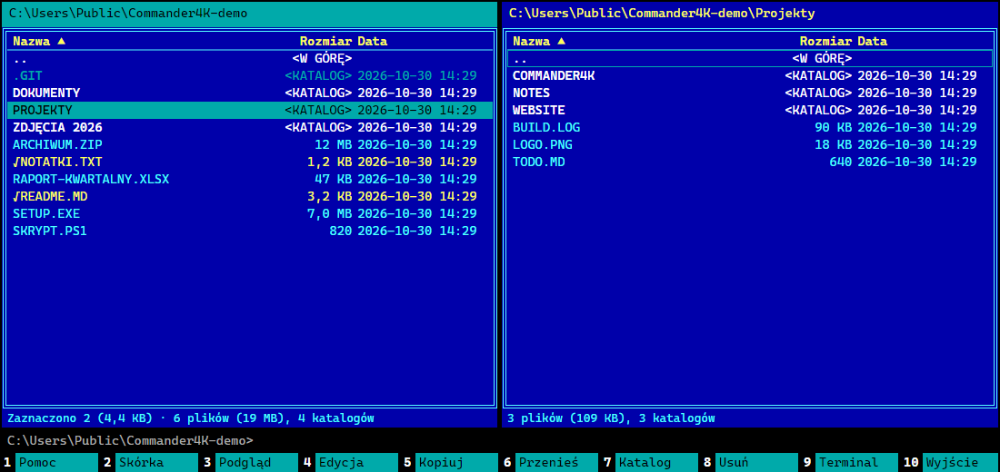
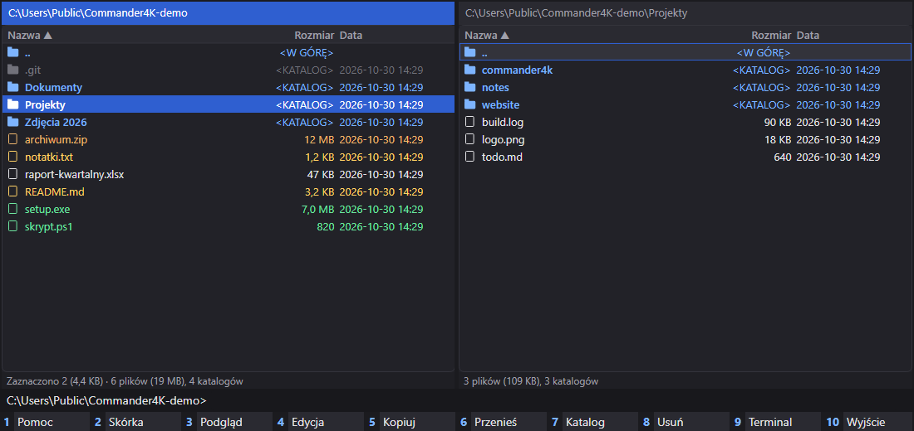
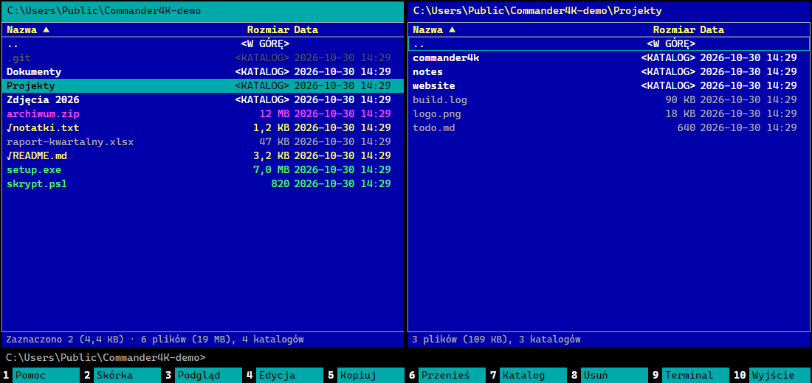
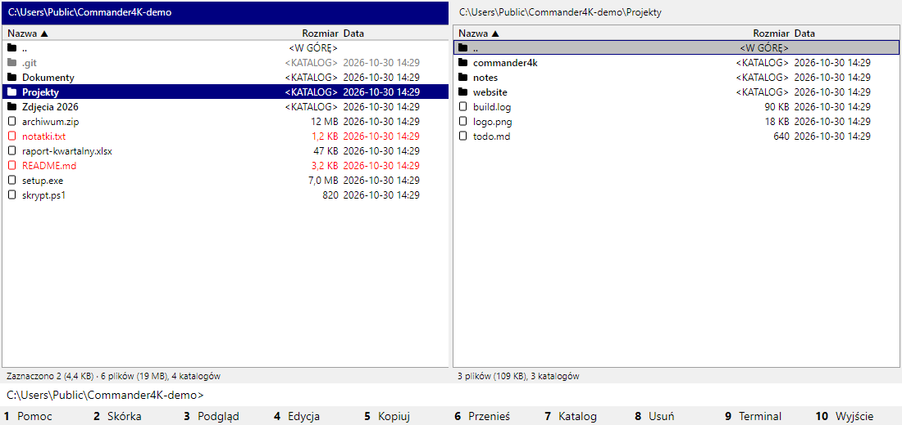

# Commander4K

[](https://github.com/4kprojekt/Commander4K/actions/workflows/ci.yml)
[](LICENSE)
[-8A2BE2.svg)](#built-with-ai)

A fast, keyboard-driven, dual-pane file manager for Windows 11 in the tradition of Norton Commander, Midnight Commander and Total Commander. Written in C# on .NET 10 with Avalonia UI (no XAML), native on x64 and ARM64.

> **Status: early preview (0.x).** It works for daily browsing, copying and searching, but expect rough edges and breaking changes.



## Features

- **Never freezes.** Disk, network, registry and database work runs off the UI thread. Listings stream in as they arrive, so the first files appear almost immediately, even in folders with hundreds of thousands of entries. `Esc` drops a hung network call at once.
- **One interface for many places:**
  - local disks;
  - `net://` network neighbourhood: finds SMB, SSH and FTP hosts on your LAN by itself;
  - SMB shares, with offline cached browsing;
  - `sftp://` and `ftp://` servers;
  - `reg://`, the Windows Registry;
  - archives (ZIP, 7z, TAR with gz/bz2/xz, RAR, GZ), opened with `Enter` like folders, even when they sit on a share or an SFTP server. `Alt+F5` packs to ZIP or TAR, and `Alt+F9` extracts.
- **Panel modes (`F2`):** either panel can show files, a quick preview, the built-in browser or any plugin panel.
- **Built-in browser (`Ctrl+Alt+W`):** a web panel based on Microsoft Edge WebView2. The address bar also searches (Google, Bing, DuckDuckGo).
  - `Ctrl+Alt+A` asks an AI assistant: ChatGPT, Claude, Perplexity or Gemini. Sign in once and the session is remembered.
  - The plugin manager's "Szukaj rozwiązania" sends a plugin's problem to that assistant, and plugins can open pages or searches here too.
- **Quick view (`Ctrl+Q`):** previews the entry under the cursor in the opposite panel:
  - Markdown is rendered with formatting, and `F4` switches to side-by-side editing with a live preview;
  - text files are editable;
  - images are shown;
  - folders show their total size and per-subfolder bars, filled in as they are computed.

  Moving the cursor cancels the running load at once. Plugins can add previews too.
- **Palettes:** button bars docked to the left, the right, the bottom or between the panels. Each palette's position is a setting.
  - Quick actions: any command, panel or plugin command, one click away.
  - Favourite folders (`Ctrl+D` adds the current one) and recently used folders.
  - Saved views: both panels' folders and modes (files, preview, plugin panel), restored with one click.
  - Plugins can add their own palettes. `Ctrl+B` shows or hides them all.
- **Total Commander-style workflow:**
  - `F5`/`F6` copy and move in the background, with an `F2` queue;
  - `F3` viewer, `F4` your editor, `F7` new folder, `F8` delete;
  - `Alt+F7` parallel search that also looks inside files;
  - `Space` shows folder sizes, `Ctrl+T` opens a tab, `Ctrl+G` jumps to a recently used folder.
- **Extra columns:** Git status, image size, date taken and camera (EXIF), and SHA-256. Each one is switched on in the settings ("Kolumny"). Values fill in the background, rows on screen first.
- **Plugin panels:**
  - system information (hardware, OS, security, hot-fixes, start-up, environment);
  - task manager, with a process tree, live CPU and memory, and per-process resources and loaded DLLs;
  - log analyzer, which groups messages into patterns and shows a per-hour timeline;
  - a catalogue of PowerShell commands you can run on the current folder or the selected files.

- **Plugins in any language:** Python, Node.js, PowerShell, .NET or any executable. Each runs as a separate process and speaks a small JSON-RPC protocol.
  - A plugin declares its permissions in `plugin.json`, and the app checks every call against them.
  - Every call is written to an audit log, and the user approves a plugin before it runs.
  - The plugin manager shows installed runtimes and their versions, with install hints for missing ones.
  - It can also create a new plugin from an example. See [docs/plugins.md](docs/plugins.md), which is written so an AI assistant can build plugins from it too.
- **Languages:** Polish and English built in, chosen automatically from Windows.
  - Any other language is one JSON file in `config/i18n/`.
  - "Translate the interface with AI" copies a ready prompt for Claude, ChatGPT or Gemini and checks the file you get back.
- **Skins:** Modern dark/light, Norton Commander, Midnight Commander and Total Commander classic. You can also make your own as JSON, or let AI design one (see below).
- **Easy to configure:**
  - `F1` (or `Ctrl+,`) opens a settings window that searches settings, shortcuts and config files;
  - `Ctrl+Shift+P` opens a command palette for every command, skin and setting;
  - every setting stays in plain JSON, so you can still edit the files by hand.
- **Self-updating:** checks GitHub Releases once a day. Before installing, it checks the download against the SHA-256 checksum published with the release.

| Modern | Midnight Commander | Total Commander classic |
|---|---|---|
|  |  |  |

## Install

From [Releases](https://github.com/4kprojekt/Commander4K/releases), pick your architecture: `win-x64` for Intel/AMD, `win-arm64` for Snapdragon and other ARM64 PCs. Then choose a package:

- **Installer** (`Commander4K-<arch>.msi`): installs into Program Files and adds a Start menu shortcut. Settings go to `%AppData%\Commander4K`. Updates download and run the next MSI.
- **Portable** (`Commander4K-<arch>.zip`): unzip anywhere and run `Commander4K.exe`. You don't need to install anything else. Settings live in a `config` folder next to the exe, and updates replace the exe in place.

Every download is listed in `SHA256SUMS.txt`, and the built-in updater refuses files that don't match.

The binaries are not code-signed yet, so Windows SmartScreen may warn on first start ("More info" → "Run anyway").

## Custom skins and AI-designed skins

Skins are JSON files in `config/skins/`. The schema is written to `config/skins/skin.schema.json` on every start. You can make a skin in three ways:

1. **Export and edit:** press `Ctrl+Shift+K` (skin picker), choose "Eksportuj do edycji", edit the JSON, then click "Przeładuj".
2. **Claude.ai or Claude Design:** "Kopiuj prompt dla Claude" copies a ready prompt with the schema and an example. Describe your idea, save the JSON you get into `config/skins/`, then reload.
3. **In the app:** "Generuj z AI…" describes a skin in words and Claude designs it, with a live preview and contrast check before you save. This option needs an Anthropic API key in `ANTHROPIC_API_KEY`, and each generation is billed by the API.

## Build from source

Requirements: Windows 10/11 and the .NET 10 SDK.

```powershell
dotnet build Commander4K.sln
dotnet test --solution Commander4K.sln
dotnet run --project src/Commander4K.App
./build-release.ps1                     # single-file ReadyToRun builds in dist/publish/<rid>
./build-release.ps1 -Version 0.2.0 -Package   # + ZIP, MSI (WiX 5) and SHA256SUMS.txt in dist/release
```

To publish a release, push a tag such as `v0.2.0`. The [release workflow](.github/workflows/release.yml) tests, builds both architectures and publishes the release assets the updater expects.

Architecture: `Commander4K.PluginSdk` (plugin contracts) → `Commander4K.Core` (VFS router, background jobs, SQLite index, keymap, updates) → `Commander4K.Plugins.BuiltIn` (local, network, registry, SFTP/FTP, search) → `Commander4K.App` (Avalonia UI). See [CLAUDE.md](CLAUDE.md) for the details.

## Built with AI

Commander4K is developed with substantial help from AI. Most of the code, tests and documentation were written by Anthropic's Claude (via [Claude Code](https://claude.com/claude-code)) under the direction of the maintainer. Commits produced this way carry a `Co-Authored-By: Claude …` trailer.

AI-written code can contain mistakes that look plausible. Review changes as you would any contribution, and please [report issues](https://github.com/4kprojekt/Commander4K/issues).

## License

[MIT](LICENSE) © 2026 4Kprojekt

---

### Po polsku

Commander4K to szybki, dwupanelowy menedżer plików dla Windows 11 w stylu Norton, Midnight i Total Commandera, na licencji MIT.

- **Interfejs:** po polsku.
- **Konfiguracja:** `Ctrl+,` otwiera ustawienia z wyszukiwarką, a `Ctrl+Shift+P` paletę komend.
- **Przeglądarka:** `Ctrl+Alt+W` otwiera stronę w panelu, a `Ctrl+Alt+A` pyta asystenta AI (ChatGPT, Gemini, Claude, Perplexity).
- **Palety:** szybkie akcje, ulubione foldery, zapisane widoki i palety wtyczek, dokowane na dole, po bokach albo między panelami (`Ctrl+B` pokazuje i ukrywa).
- **Skórki:** są w `config/skins`. Możesz też wygenerować je z pomocą AI.
- **Aktualizacje:** pobierane z GitHub Releases.

Projekt powstaje z dużym udziałem AI (Claude Code). Błędy zgłaszaj w zakładce Issues.
