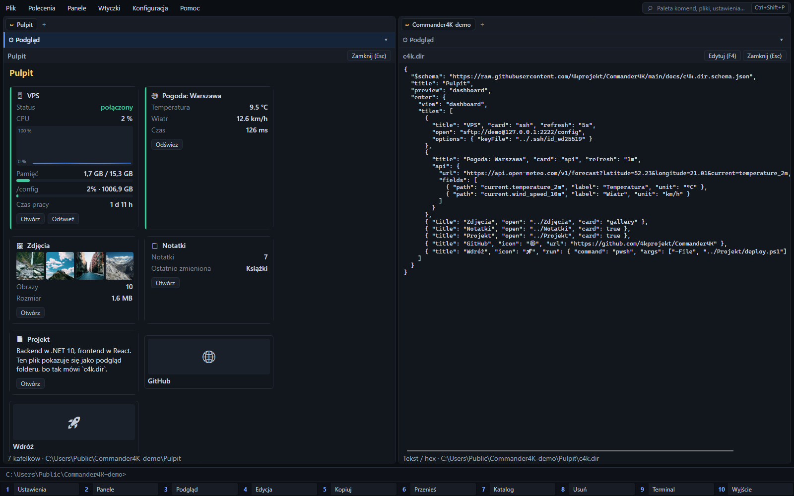
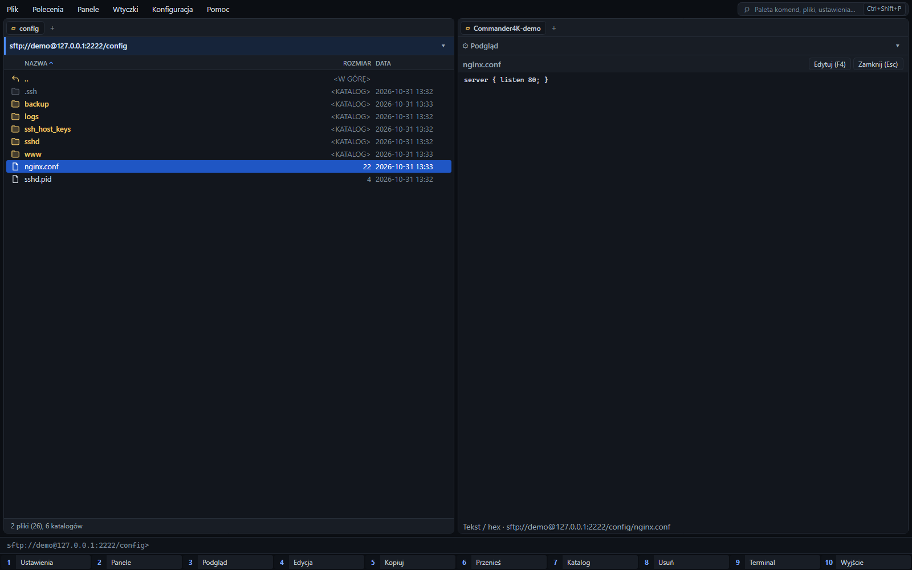
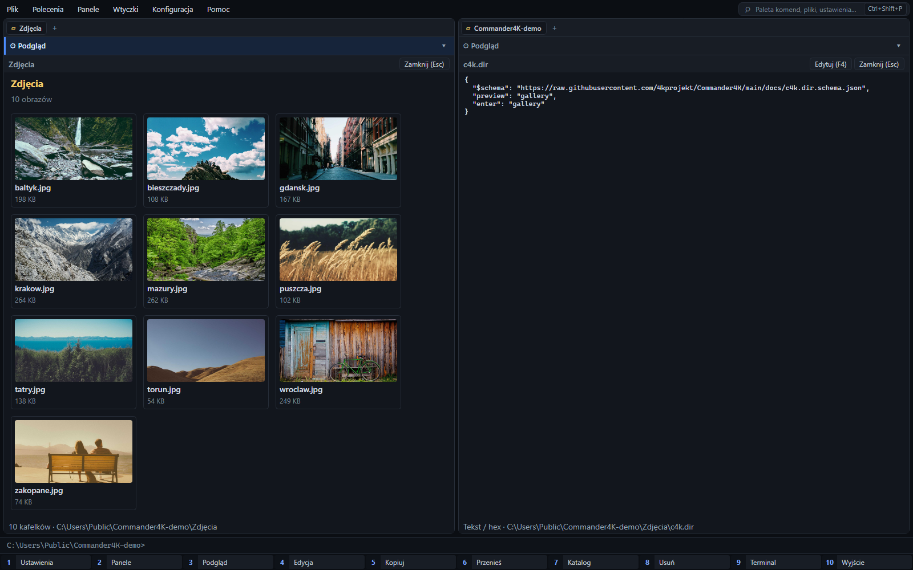
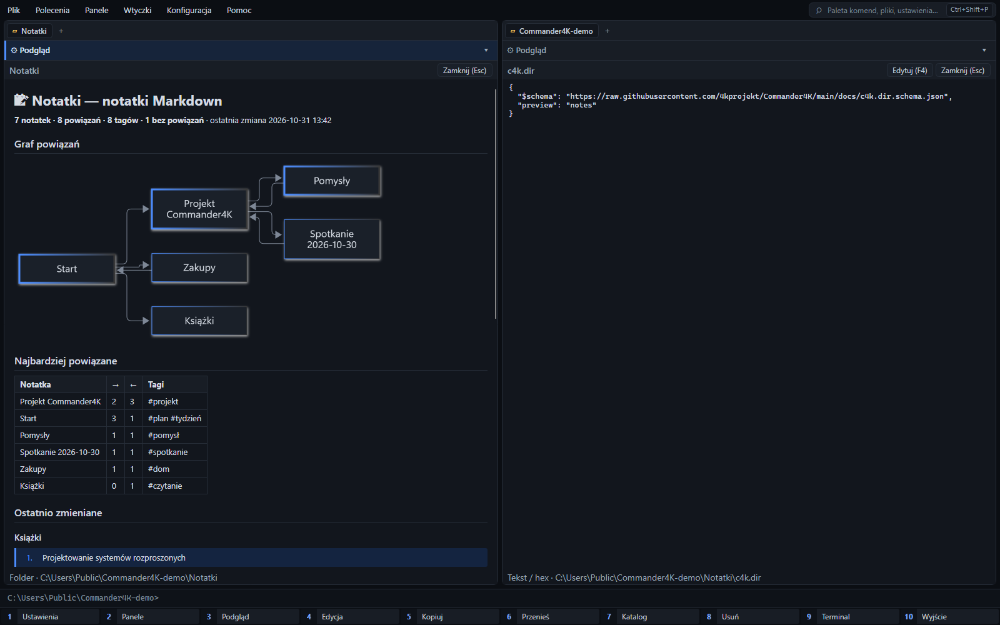
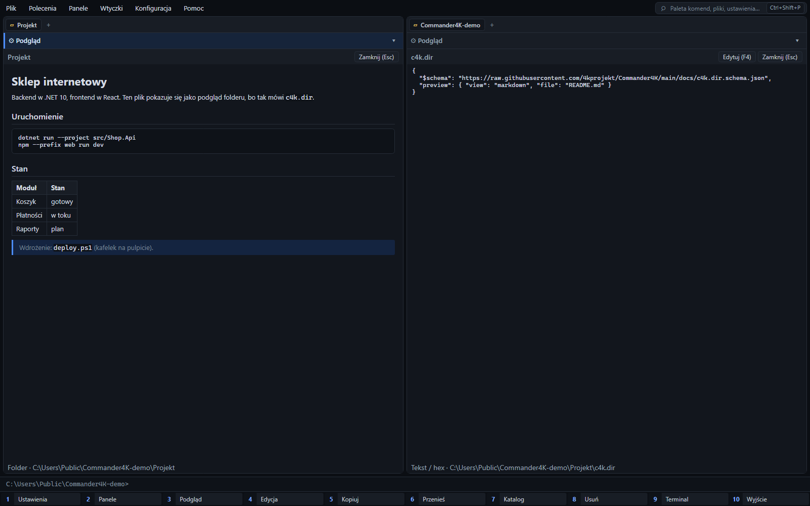

#  Commander4K

[](https://github.com/4kprojekt/Commander4K/actions/workflows/ci.yml)
[](LICENSE)
[-8A2BE2.svg)](#built-with-ai)

A fast, keyboard-driven, dual-pane file manager for Windows 11 in the tradition of Norton Commander, Midnight Commander and Total Commander. Written in C# on .NET 10 with Avalonia UI (no XAML), native on x64 and ARM64.

> **Status: early preview (0.x).** It works for daily browsing, copying and searching, but expect rough edges and breaking changes.


## Features

- **Never freezes.** Disk, network, registry and database work runs off the UI thread. Listings stream in as they arrive, so the first files appear almost immediately, even in folders with hundreds of thousands of entries. `Esc` drops a hung network call at once.
- **One interface for many places:**
  - local disks;
  - `net://` network neighbourhood: finds SMB, SSH and FTP hosts on your LAN by itself;
  - SMB shares, with offline cached browsing;
  - `sftp://` and `ftp://` servers;
  - `reg://`, the Windows Registry;
  - archives (ZIP, 7z, TAR with gz/bz2/xz, RAR, GZ), opened with `Enter` like folders, even when they sit on a share or an SFTP server. `Alt+F5` packs to ZIP or TAR, and `Alt+F9` extracts.
- **This PC (`local://`):** shows drives, the system and user folders (Desktop, Documents, Downloads…, Program Files, AppData, Temp), then the network: saved connections, Windows network locations, and LAN hosts as background discovery finds them. The ▾ button on each panel's path bar switches the panel to any of these, or adds a connection.
- **Connections:** SFTP/SSH with a password or a private key (passphrase optional). Your `~/.ssh` keys are tried automatically, as `ssh` does. Also FTP and Windows shares. "Testuj" checks a connection before saving it. Passwords and passphrases are stored DPAPI-encrypted in `config/settings.json`.
- **Panel modes (`F2`):** either panel can show files, a quick preview, the built-in browser or any plugin panel.
- **Built-in browser (`Ctrl+Alt+W`):** a web panel based on Microsoft Edge WebView2. The address bar also searches (Google, Bing, DuckDuckGo).
  - Without AI providers signed in (see below), `Ctrl+Alt+A` shows the question for Claude Code (copied to the clipboard).
- **AI chat with free providers (`Ctrl+Alt+A`):** sign in to several free API tiers in "Konfiguracja → Dostawcy AI". Questions go to them in turn; when one hits its rate limit or quota, or rejects its key, the next one answers.
  - Providers: OpenRouter (one-click browser sign-in, no key to copy), Groq, Cerebras, Google AI Studio, Mistral, NVIDIA NIM, Hugging Face and Cohere, plus local models through Ollama or LM Studio (no account, no limits, nothing leaves the PC; the window detects them, shows install steps and can install them with winget). Keys can also come from environment variables (`OPENROUTER_API_KEY`, `GROQ_API_KEY`…).
  - The provider list ([`ai-providers.json`](src/Commander4K.Core/Ai/ai-providers.json)) is downloaded from this repository at start-up, so endpoints and free models can be updated without a new release. Add your own in `config/ai/providers.json`.
  - The AI knows where you are: it gets both panels' paths, the cursor, the marked files and the installed plugins. It can look into folders, and it reads a file only after you allow it.
  - **Plugins written by AI:** "Napisz wtyczkę z AI" gives the model the [plugin guide](docs/plugins.md) and installs the plugin from its answer. The plugin stays disabled until you approve its permissions.
  - **Claude Code:** the question or plugin request is copied for you to paste there. An MCP server, so that Claude Code can read the app state and write and install plugins itself, is in progress (see [Claude Code and MCP](#claude-code-and-mcp-in-progress)).
  - Keys are stored in `config/ai/credentials.json`, encrypted for the current Windows user (DPAPI). After moving a portable copy to another account or PC, sign in again.
  - The plugin manager's "Szukaj rozwiązania" sends a plugin's problem to that assistant, and plugins can open pages or searches here too.
- **Claude Code over MCP:** Commander4K runs a local MCP server (127.0.0.1 only, with a token). Open "Połącz Claude Code" (command palette, or the MCP badge in the status bar), switch it on, add the folders the AI may use and run the `claude mcp add …` command it shows. Claude Code can then browse those folders, drive the panels, and write, check, install and try plugins. Every tool can be set to allow, ask or block. Risky calls (reading and writing files, running commands, installing or enabling a plugin) open a confirmation in the app. The app's own plugin, `config/` and `data/` folders cannot be read or written through MCP, and every call is logged. Details: [plugin guide](docs/plugins.md#writing-plugins-with-claude-code-over-mcp).
- **Quick view (`Ctrl+Q`):** previews the entry under the cursor in the opposite panel:
  - Markdown is rendered with formatting, and `F4` switches to side-by-side editing with a live preview. ` ```mermaid ` diagrams are drawn offline with the bundled [Mermaid](https://mermaid.js.org) 12.2.0 (MIT), in the skin's colours;
  - the folder preview adapts to the content: an Obsidian vault, or a folder of Markdown notes, shows a link graph, the most linked notes, recent notes with excerpts, tags, unlinked notes and broken links. Obsidian `.canvas` boards show as diagrams;
  - text files are editable;
  - images are shown;
  - folders show their total size and per-subfolder bars, filled in as they are computed.

  Moving the cursor cancels the running load at once. Plugins can add previews too, including HTML/JS pages in a sandboxed WebView2 ([web previews](docs/plugins.md#web-previews)); [`examples/plugins/pdf-viewer-node`](examples/plugins/pdf-viewer-node) shows PDFs with PDF.js (search, zoom, print).
- **Folders that decide how they look (`c4k.dir`):** a small JSON file in a folder sets what its preview shows and what `Enter` does ([guide](docs/plugins.md#folder-files-c4kdir), [schema](docs/c4k.dir.schema.json)). `Shift+Enter` always opens the plain file list.
  - It can show a photo gallery, a dashboard of tiles (folders, pages, scripts), the notes view, a README, or a plugin's view (for example the games of a Steam library, with covers).
  - It can open an SFTP server with a key, a web page in the panel browser, or run a script. A script runs only after you have seen the command and trusted that exact file; a changed or copied file asks again.
  - "Widok folderu (c4k.dir)" in the command palette writes the file for you.
  - [Examples](#examples-folders-that-configure-themselves) shows screenshots together with their `c4k.dir` files.
  - Dashboard tiles can be live cards drawn by previews: folder statistics, gallery thumbnails, fields of any HTTP API (with charts that grow on every refresh), an SSH server's CPU, memory and disks, or another dashboard to open. Each card refreshes on its own interval while visible. "Dodaj kartę API" asks an API once and lets you pick the fields. Cards that sign in or change something wait until you trust the file, and API tokens stay encrypted outside it.
- **Official plugin catalog:** [`plugins-catalog/catalog.json`](plugins-catalog/catalog.json) is downloaded at start-up. Its plugins install from the plugin manager (`Ctrl+I`), or with one click when a `c4k.dir` needs one.
  - Every file is checked against the catalog's SHA-256.
  - A new plugin stays disabled until you approve its permissions.
  - Official plugins so far: `official.steam-library` (a Steam library as tiles and a table) and `official.git-repo` (a Git repository at a glance: branch and upstream, changes, recent commits, branches, tags, remotes).
- **Total Commander-style workflow:**
  - `F5`/`F6` copy and move in the background, with an `F2` queue;
  - `F3` viewer, `F4` your editor, `F7` new folder, `F8` delete;
  - `Alt+F7` parallel search that also looks inside files;
  - `Space` shows folder sizes, `Ctrl+T` opens a tab, `Ctrl+G` jumps to a recently used folder.
- **Extra columns:** Git status, image size, date taken and camera (EXIF), and SHA-256. Each one is switched on in the settings ("Kolumny"). Values fill in the background, rows on screen first.
- **Plugin panels:**
  - system information (hardware, OS, security, hot-fixes, start-up, environment);
  - task manager, with a process tree, live CPU and memory, and per-process resources and loaded DLLs;
  - log analyzer, which groups messages into patterns and shows a per-hour timeline;
  - a catalogue of PowerShell commands you can run on the current folder or the selected files.

- **Plugins in any language:** Python, Node.js, PowerShell, .NET or any executable. Each runs as a separate process and speaks a small JSON-RPC protocol.
  - A plugin declares its permissions in `plugin.json`, and the app checks every call against them.
  - Every call is written to an audit log, and the user approves a plugin before it runs.
  - The plugin manager shows installed runtimes and their versions, with install hints for missing ones.
  - It can also create a new plugin from an example. See [docs/plugins.md](docs/plugins.md), which is written so an AI assistant can build plugins from it too.
- **Languages:** Polish and English built in, chosen automatically from Windows.
  - Any other language is one JSON file in `config/i18n/`.
  - "Translate the interface with AI" copies a ready prompt for Claude, ChatGPT or Gemini and checks the file you get back.
- **Skins:** Modern dark/light, Norton Commander, Midnight Commander and Total Commander classic. You can also make your own as JSON, or let AI design one (see below).
- **Easy to configure:**
  - `F1` (or `Ctrl+,`) opens a settings window that searches settings, shortcuts and config files;
  - `Ctrl+Shift+P` opens a command palette for every command, skin and setting;
  - every setting stays in plain JSON, so you can still edit the files by hand.
- **Self-updating:** checks GitHub Releases once a day. Before installing, it checks the download against the SHA-256 checksum published with the release.

| Modern | Midnight Commander | Total Commander classic |
|---|---|---|
|  |  |  |

## Examples: folders that configure themselves

Each screenshot below was taken in the app (skin *Modern*). The left panel shows the folder's view and the right panel shows the folder's `c4k.dir`; the same file is printed under each screenshot, so you can copy it. The file goes into the folder it describes. `Ctrl+Q` shows the `preview`, `Enter` runs `enter`, and `Shift+Enter` always opens the plain file list. Full reference: [guide](docs/plugins.md#folder-files-c4kdir), [schema](docs/c4k.dir.schema.json).

### Dashboard with live cards: SSH server, HTTP API, gallery, notes



`Pulpit/c4k.dir`:

```json
{
  "$schema": "https://raw.githubusercontent.com/4kprojekt/Commander4K/main/docs/c4k.dir.schema.json",
  "title": "Pulpit",
  "preview": "dashboard",
  "enter": {
    "view": "dashboard",
    "tiles": [
      {
        "title": "VPS", "card": "ssh", "refresh": "5s",
        "open": "sftp://demo@127.0.0.1:2222/config",
        "options": { "keyFile": "../.ssh/id_ed25519" }
      },
      {
        "title": "Pogoda: Warszawa", "card": "api", "refresh": "1m",
        "api": {
          "url": "https://api.open-meteo.com/v1/forecast?latitude=52.23&longitude=21.01&current=temperature_2m,wind_speed_10m",
          "fields": [
            { "path": "current.temperature_2m", "label": "Temperatura", "unit": "°C" },
            { "path": "current.wind_speed_10m", "label": "Wiatr", "unit": "km/h" }
          ]
        }
      },
      { "title": "Zdjęcia", "open": "../Zdjęcia", "card": "gallery" },
      { "title": "Notatki", "open": "../Notatki", "card": true },
      { "title": "Projekt", "open": "../Projekt", "card": true },
      { "title": "GitHub", "icon": "🌐", "url": "https://github.com/4kprojekt/Commander4K" },
      { "title": "Wdróż", "icon": "🚀", "run": { "command": "pwsh", "args": ["-File", "../Projekt/deploy.ps1"] } }
    ]
  }
}
```

- `"card": "ssh"` signs in to the server (here with the key from `options.keyFile`, relative to the folder) and shows status, CPU (a chart that grows on each refresh), memory, disks and uptime. It runs one fixed, read-only command.
- `"card": "api"` asks an HTTP API and shows the chosen fields. `cm_AddApiCard` ("Dodaj kartę API") asks the API once and writes such a tile for you. Tokens go into headers as `{secret:name}` and stay encrypted outside the file.
- `"card": true` draws whatever `Ctrl+Q` would show for the target, so the notes and the README come from their folders' own `c4k.dir`.
- Tiles without `card` are shortcuts: `url` opens the page in the panel browser, `run` runs a command.
- SSH cards (and API cards that change something) stay locked until you trust this exact file. A changed or copied file asks again.

### SFTP server with a private key on `Enter`



`VPS/c4k.dir`:

```json
{
  "$schema": "https://raw.githubusercontent.com/4kprojekt/Commander4K/main/docs/c4k.dir.schema.json",
  "title": "VPS",
  "enter": {
    "open": "sftp://demo@127.0.0.1:2222/config",
    "keyFile": "../.ssh/id_ed25519"
  }
}
```

`Enter` on the folder opens the server in the same panel, so copying (`F5`), viewing and editing work as on a local disk. The key is used for this session only. Without `keyFile`, saved connections and your `~/.ssh` keys are tried, as `ssh` does. To keep a password or key, save a connection ("Dodaj połączenie"); never put secrets in `c4k.dir`.

### Photo gallery



`Zdjęcia/c4k.dir`:

```json
{
  "$schema": "https://raw.githubusercontent.com/4kprojekt/Commander4K/main/docs/c4k.dir.schema.json",
  "preview": "gallery",
  "enter": "gallery"
}
```

### Markdown notes with a link graph



`Notatki/c4k.dir`:

```json
{
  "$schema": "https://raw.githubusercontent.com/4kprojekt/Commander4K/main/docs/c4k.dir.schema.json",
  "preview": "notes"
}
```

The `[[links]]` between notes become a [Mermaid](https://mermaid.js.org) graph, drawn offline. An Obsidian vault gets this view even without a `c4k.dir`.

### Project README as the folder preview



`Projekt/c4k.dir`:

```json
{
  "$schema": "https://raw.githubusercontent.com/4kprojekt/Commander4K/main/docs/c4k.dir.schema.json",
  "preview": { "view": "markdown", "file": "README.md" }
}
```

<details>
<summary>How the screenshots were made</summary>

The folders above live in `C:\Users\Public\Commander4K-demo`. The SSH/SFTP server is a local container that accepts the demo key from `.ssh` in that folder:

```powershell
docker run -d --name c4k-ssh -p 127.0.0.1:2222:2222 -e USER_NAME=demo -e PASSWORD_ACCESS=false `
  -e "PUBLIC_KEY=$(Get-Content C:\Users\Public\Commander4K-demo\.ssh\id_ed25519.pub)" lscr.io/linuxserver/openssh-server
```

The weather card reads the free [Open-Meteo](https://open-meteo.com) API, which needs no key.
</details>

## Claude Code and MCP (in progress)

Commander4K is becoming an [MCP](https://modelcontextprotocol.io) server, so Claude Code (or any MCP client) can work with the app directly: read where you are, move the panels, read and write files in every place the app can open (disks, shares, SFTP, archives, the registry), use plugins, and write, check and install new plugins in a loop until they work.

**Status:** the protocol (Streamable HTTP, MCP 2025-06-18), the loopback transport and the safety policy are done. The tools, the settings window and the "connect" dialog are not finished, so the server can't be switched on from the app yet.

How it is designed to work:

- **Off by default.** It listens only on `127.0.0.1` (port `47800` by default) and every request needs a random bearer token, stored DPAPI-encrypted. Requests from web pages (a foreign `Origin`) are refused.
- **Connecting:** a "Połącz Claude Code" command will show the line to paste:

  ```powershell
  claude mcp add --transport http commander4k http://localhost:47800/mcp --header "Authorization: Bearer <token>"
  ```

- **Allowed folders:** tools may touch only the folders you list (`allowedRoots`: any path the app understands, such as `C:\Projects` or `sftp://me@nas/srv`). Everything else is refused, whatever the tool's mode. The app's `config` folder and installed plugins can't be written over MCP.
- **Per-tool mode:** each tool is *allow*, *ask* or *block* (`toolModes`). Reading the app context and listing folders are allowed by default; reading or writing files and running commands ask first. Moving, deleting, installing and enabling plugins always ask.
- **Plugins:** `get_plugin_guide`, `check_plugin` and `install_plugin` give Claude the [plugin guide](docs/plugins.md), the app's own lint and the normal installer. A new plugin stays disabled until you approve its permissions.
- **Audit:** every call is written to the log with its decision and result.

The planned section of `config/settings.json`:

```json
"mcp": {
  "enabled": true,
  "port": 47800,
  "allowedRoots": [ "C:\\Projects", "sftp://demo@127.0.0.1:2222/config" ],
  "toolModes": { "read_file": "allow", "write_file": "ask", "run_command": "block" }
}
```

Until then, "Ask AI" and "Write a plugin with AI" without a signed-in provider copy a ready prompt for Claude Code to the clipboard.

## Install

From [Releases](https://github.com/4kprojekt/Commander4K/releases), pick your architecture: `win-x64` for Intel/AMD, `win-arm64` for Snapdragon and other ARM64 PCs. Then choose a package:

- **Installer** (`Commander4K-<arch>.msi`): installs into Program Files and adds a Start menu shortcut. Settings go to `%AppData%\Commander4K`. Updates download and run the next MSI.
- **Portable** (`Commander4K-<arch>.zip`): unzip anywhere and run `Commander4K.exe`. You don't need to install anything else. Settings live in a `config` folder next to the exe, and updates replace the exe in place.

Every download is listed in `SHA256SUMS.txt`, and the built-in updater refuses files that don't match.

The binaries are not code-signed yet, so Windows SmartScreen may warn on first start ("More info" → "Run anyway").

## Custom skins and AI-designed skins

Skins are JSON files in `config/skins/`. The schema is written to `config/skins/skin.schema.json` on every start. You can make a skin in three ways:

1. **Export and edit:** press `Ctrl+Shift+K` (skin picker), choose "Eksportuj do edycji", edit the JSON, then click "Przeładuj".
2. **Claude.ai or Claude Design:** "Kopiuj prompt dla Claude" copies a ready prompt with the schema and an example. Describe your idea, save the JSON you get into `config/skins/`, then reload.
3. **In the app:** "Generuj z AI…" describes a skin in words and Claude designs it, with a live preview and contrast check before you save. This option needs an Anthropic API key in `ANTHROPIC_API_KEY`, and each generation is billed by the API.

## Build from source

Requirements: Windows 10/11 and the .NET 10 SDK.

```powershell
dotnet build Commander4K.sln
dotnet test --solution Commander4K.sln
dotnet run --project src/Commander4K.App
./build-release.ps1                     # single-file ReadyToRun builds in dist/publish/<rid>
./build-release.ps1 -Version 0.2.0 -Package   # + ZIP, MSI (WiX 5) and SHA256SUMS.txt in dist/release
```

**VS Code:** open the repository folder and accept the recommended extensions (C#, C# Dev Kit).
- `F5` builds and debugs the app; the "English UI" profile sets `C4K_LANGUAGE=en` for that run.
- `Ctrl+Shift+B` builds; *Tasks: Run Test Task* runs the tests.
- The tasks also include `run`, `watch`, `test (filter)` and `release (local)`.
- `plugin.json` files get schema completion.

From the app, `Ctrl+Shift+E` opens the current folder (and the marked files) in VS Code.

To publish a release, push a tag such as `v0.2.0`. The [release workflow](.github/workflows/release.yml) tests, builds both architectures and publishes the release assets the updater expects.

Architecture: `Commander4K.PluginSdk` (plugin contracts) → `Commander4K.Core` (VFS router, background jobs, SQLite index, keymap, updates) → `Commander4K.Plugins.BuiltIn` (local, network, registry, SFTP/FTP, search) → `Commander4K.App` (Avalonia UI). See [CLAUDE.md](CLAUDE.md) for the details.

## Built with AI

Commander4K is developed with substantial help from AI. Most of the code, tests and documentation were written by Anthropic's Claude (via [Claude Code](https://claude.com/claude-code)) under the direction of the maintainer. Commits produced this way carry a `Co-Authored-By: Claude …` trailer.

AI-written code can contain mistakes that look plausible. Review changes as you would any contribution, and please [report issues](https://github.com/4kprojekt/Commander4K/issues).

## License

[MIT](LICENSE) © 2026 4Kprojekt

---

### Po polsku

Commander4K to szybki, dwupanelowy menedżer plików dla Windows 11 w stylu Norton, Midnight i Total Commandera, na licencji MIT.

- **Interfejs:** po polsku.
- **Konfiguracja:** `Ctrl+,` otwiera ustawienia z wyszukiwarką, a `Ctrl+Shift+P` paletę komend.
- **Przeglądarka:** `Ctrl+Alt+W` otwiera stronę w panelu.
- **Czat AI (`Ctrl+Alt+A`):** zaloguj się do kilku darmowych dostawców w „Konfiguracja → Dostawcy AI” (OpenRouter jednym kliknięciem, Groq, Cerebras, Mistral…) albo uruchom modele lokalnie w Ollamie lub LM Studio — okno pokazuje instrukcję i instaluje je przez winget. Gdy jeden wyczerpie limit, odpowiada następny. Bez logowania `Ctrl+Alt+A` otwiera asystenta w przeglądarce. AI zna stan aplikacji (ścieżki, zaznaczenie, wtyczki) i potrafi napisać wtyczkę według przewodnika, a aplikacja ją instaluje (wyłączoną do Twojej zgody). Gemini, ChatGPT i Claude otwarte w panelu przeglądarki dostają ten sam kontekst z menu „🤖 AI”.
- **Foldery z własnym widokiem (`c4k.dir`):** pulpit z kartami (serwer SSH, API HTTP, galeria, notatki), SFTP z kluczem po `Enter`, galeria zdjęć, graf notatek. Zrzuty ekranu razem z plikami konfiguracji są w sekcji [Examples](#examples-folders-that-configure-themselves).
- **MCP dla Claude Code (w przygotowaniu):** Claude Code będzie mógł czytać stan aplikacji, pracować na plikach w dozwolonych folderach i pisać wtyczki. Każde narzędzie ma tryb: zezwalaj, pytaj albo zablokuj ([szczegóły](#claude-code-and-mcp-in-progress)).
- **Skórki:** są w `config/skins`. Możesz też wygenerować je z pomocą AI.
- **Aktualizacje:** pobierane z GitHub Releases.

Projekt powstaje z dużym udziałem AI (Claude Code). Błędy zgłaszaj w zakładce Issues.
